# 9.7 遊戲手冊

給測試人員與玩家看的手冊原稿，一份到底：前半「跟著做」帶人從開遊戲走到讀懂一件事的前因，後半是查閱用的對照表、現有系統總表與已知問題。每一節最後的「測試項目」是要測試人員照著做並回報的事。內容只寫畫面上看得到、做得到的事。

`python tools/release/manual.py` 把本頁第一個二級標題之後的內容轉成 PDF，封面與版本由腳本加上，預設輸出到 `builds/manual/`。截圖放在 `sources/manual/`，原稿用獨立成段的 `` 引用；要框出來的地方記在 `sources/manual/marks.json`（檔名 → `[x, y, 寬, 高]` 清單，1920×1080 的畫面座標），腳本依序疊上紅框與編號，圖下的編號清單照同一個順序寫。截圖條件：新開的世界、視窗 1920×1080、介面縮放 100%，存成 1280×720 的 JPEG。介面或玩法改了，那一步重截、標示跟著改。本版截圖取自 2026-10-13 的實機盤點（中型世界，種子 20261013；飛升一張取自小型世界，種子 4242）。

## 這個遊戲在玩什麼

你是司命，掌管命簿的神。眼前是一整個修仙世界：幾十到上百個州郡、幾千萬凡人、幾千個有名有姓的修士。他們出生、入道、結怨、成婚、渡劫、身死，死後魂入輪迴，帶著上輩子沒了結的恩怨再投胎。這些事不等你，時間一走就自己發生。

這一版你能做的只有「看」：

- 在地圖上移動、拉遠拉近，看哪裡出了事。
- 讀右上角的傳聞，知道天下剛發生什麼。
- 翻開一個州、一個人、一件事的命簿，看它的來歷。
- 對一件事「溯因」，一路往回看到幾十年、幾世之前是誰欠了誰。

這一版還不能做的：出手改變任何人的命運、關注某個人、翻天書。那些是設計中的玩法，還沒做進來，詳見「現有系統總表」。所以現在測的重點是：**看不看得懂**——畫面上的字與圖能不能讓你明白世界正在發生什麼、為什麼發生。

手冊怎麼用：

- 「跟著做」照順序走一遍，大約 20 分鐘。每一步有實機截圖，紅框編號對應圖下同一個號碼的說明。
- 世界是用種子生出來的，你的地圖與人名不會和截圖一樣；照每一步的目的做就可以。
- 每節最後的「測試項目」逐條做，做不到或看不懂的記下來，回報方式在最後一章。

## 跟著做：開一個世界

執行遊戲，會看到主選單。

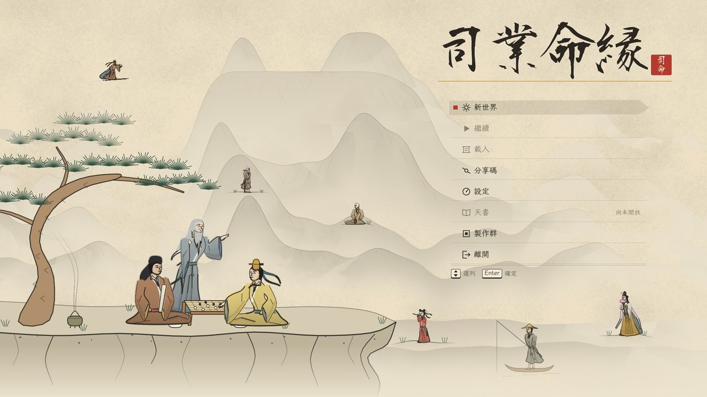

1. 選單。由上到下：新世界、繼續、載入、分享碼、設定、天書、製作群、離開。還沒有存檔時「繼續」與「載入」是灰的；「天書」標著「尚未開放」。用上下鍵選列、Enter 確定，或直接用滑鼠點。

先進「設定」看一眼。

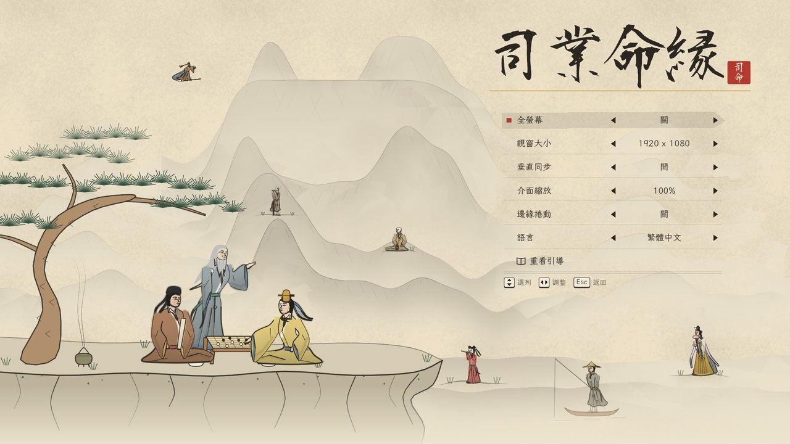

1. 設定共七列：全螢幕、視窗大小、垂直同步、介面縮放、邊緣捲動、語言、重看引導。左右鍵調整。字太小就把介面縮放調大；「邊緣捲動」開著時，滑鼠貼到畫面邊緣地圖會跟著捲。按 Esc 回主選單。

回主選單選「新世界」。

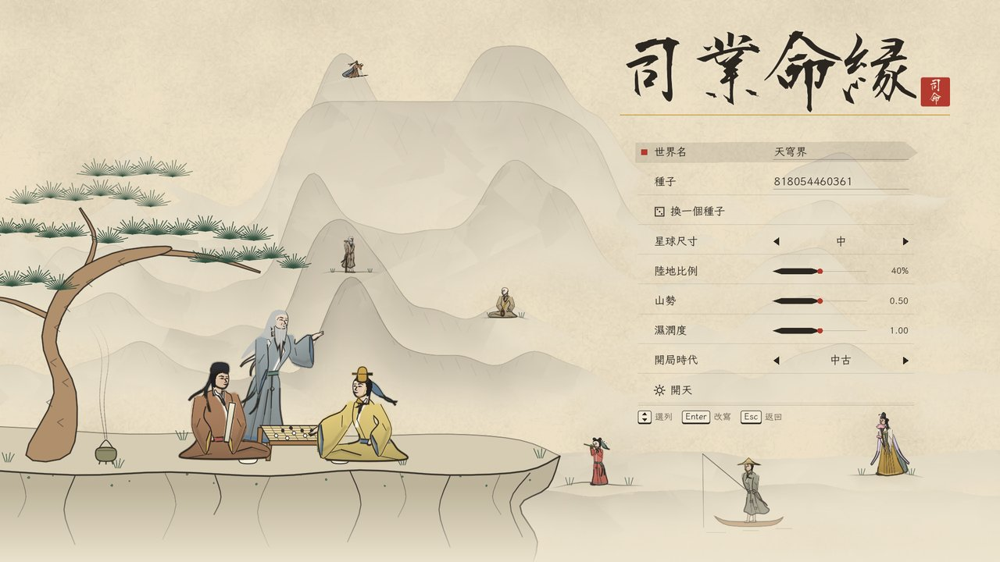

1. 開新世界的選項：世界名、種子、換一個種子、星球尺寸、陸地比例、山勢、濕潤度、開局時代，最下面是「開天」。第一次玩全部用預設值，直接選「開天」。同一個種子加同樣的選項，生出來的世界一模一樣。

畫面顯示「天地初分，稍候片刻」。這段時間遊戲在生出地形並讓世界先自己跑幾十年，中型世界大約等 27 秒，小型約 12 秒。等完後鏡頭會從高空飛下來，落定就進了世界。

**測試項目**

- [ ] 主選單八列都在；沒有存檔時「繼續」「載入」點不動。
- [ ] 設定七列都能用左右鍵調整；介面縮放調到 150% 後，字沒有被切掉或疊在一起。
- [ ] 「換一個種子」每按一次種子都不同。
- [ ] 預設值按「開天」能進世界；記下等了幾秒。
- [ ] 把星球尺寸、陸地比例、山勢、濕潤度、開局時代各改一輪，仍能開天。

## 跟著做：認識畫面

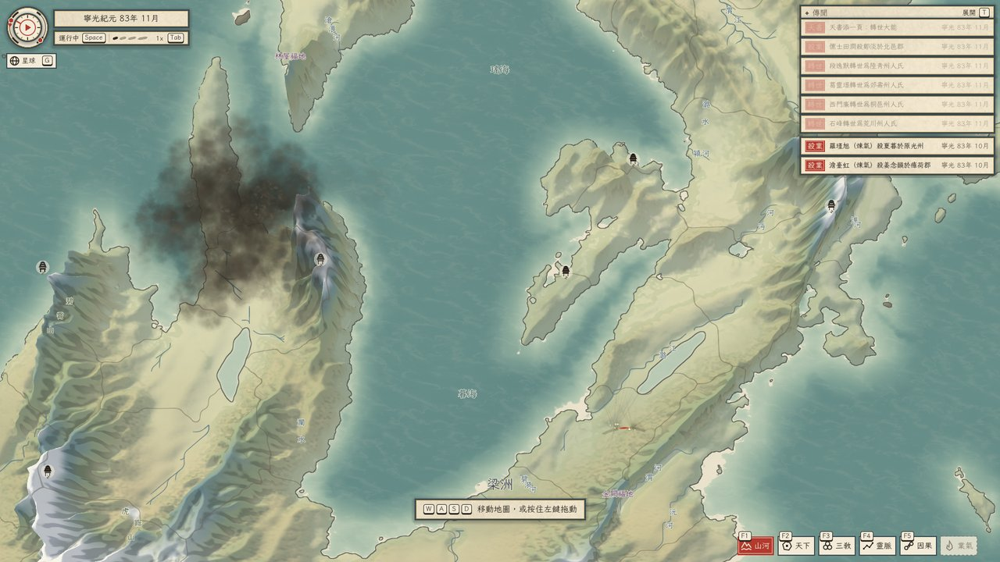

1. 天時儀：圓盤中心是暫停鈕，點一下時間停住，再點一下繼續。外圈兩段弧線，滑鼠停在上面會顯示現在的寒暖與靈潮，例如「寒暖：平常，轉寒」「靈潮：末法，持平」。正下方的小鈕是視角鈕，在平面地圖與星球之間切換（G）。
2. 上面一格是日期：只寫紀元時間，例如「寧光紀元 八三年 十一月」——這個紀元的第幾年；開天後世界已經自己過了很久，所以不是從元年開始。世界活了多久、換過幾個紀元，翻天下冊（B）首頁頂端的世界簡史。下面一格是狀態列：左邊「運行中」或「已暫停」（Space 切換），右邊是速度（Tab 切換）。
3. 傳聞簽：天下剛發生的事，最多列八張。沒事時寫「天下無事」。
4. 引導簽：遊戲內的操作教學，一次一句，照做了就換下一句，共六句。
5. 印匣：六種地圖模式，F1 到 F6。最右邊的「業氣」是灰的，還沒開放。

地圖上小小的黑色樓閣是宗門的山門；灰黑的雲團與橘色的電光是有人正在渡天劫（後面會講）。

**測試項目**

- [ ] 天時儀、視角鈕、日期、狀態列、傳聞簽、引導簽、印匣七樣東西都找得到，彼此不重疊。
- [ ] 滑鼠停在天時儀外圈的兩段弧線上，各出現一句說明。
- [ ] 不看手冊，只看畫面，說得出現在是幾年幾月、時間有沒有在走、速度多快。

## 跟著做：移動、拉遠拉近、換視角

照引導簽的六句做一遍，它們教的就是這一節與下一節的操作。

- **移動**：W、A、S、D 或方向鍵；或按住滑鼠左鍵拖動地圖。
- **拉遠拉近**：滾輪，或 `=` 拉近、`-` 拉遠。拉近看得到州名、城名與河名，拉遠看得到整片大陸。
- **轉向**：Q、E，或按住滑鼠右鍵拖動。左右各只能轉 45°。
- **星球視角**：按 G，或點左上的視角鈕。

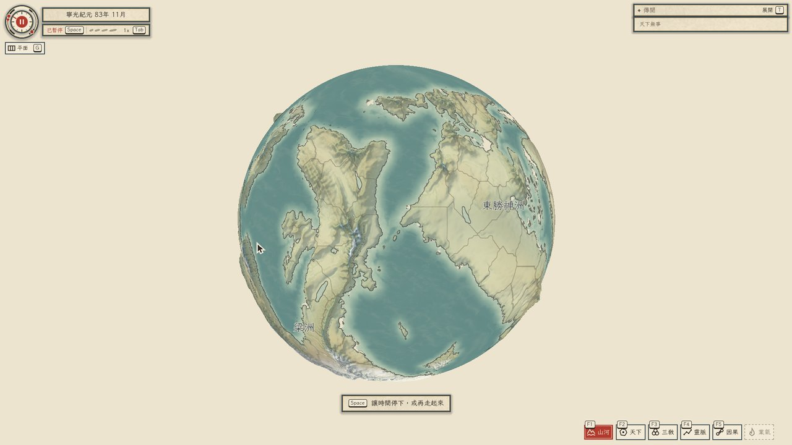

1. 整個世界是一顆球。平面地圖是把它攤開來看；星球視角下一樣可以移動、拉近、點州郡。左上的視角鈕這時寫「平面」，再按一次 G 回到平面地圖。

**測試項目**

- [ ] 鍵盤、左鍵拖動兩種移動方式都有效。
- [ ] 滾輪與 `=`／`-` 都能縮放；拉到最近與最遠各停得住，不會穿過地面或飛出去。
- [ ] Q、E 與右鍵拖動都能轉向，轉到底會停。
- [ ] G 來回切換兩種視角各三次，畫面都正常。
- [ ] 六句引導簽都出現過，做到了就換下一句，六句做完後不再出現；設定裡的「重看引導」能讓它從頭再來。

## 跟著做：讓時間走

- **暫停與繼續**：Space，或點天時儀的中心。
- **換速度**：Tab，依序是 1×、5×、10×、20×，再按回到 1×。也可以直接點狀態列上的刻線。

世界的最小單位是一個月。1× 大約每秒過兩個月，20× 每秒過三四年。想仔細看一件事就暫停；想看世界變化就開 20× 放著跑幾分鐘。

**測試項目**

- [ ] Space 與點天時儀中心都能暫停、繼續；暫停時狀態列寫「已暫停」，日期不動。
- [ ] Tab 按四次，速度依序是 5×、10×、20×、1×。
- [ ] 20× 連續跑 10 分鐘，遊戲不當掉、不明顯變卡；記下跑到幾年。

## 跟著做：翻開一個州

把滑鼠移到陸地上。

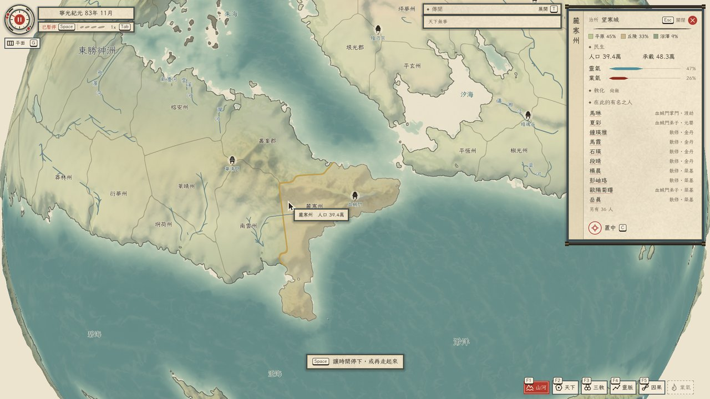

1. 游標停在一個州上，會出現州名與人口，那個州的邊界也會亮起來。
2. 點下去，右邊翻開這個州的命簿：治所（州城的名字）、地形占比、人口與承載、靈氣與業氣兩條墨條、教化、住在這裡的有名之人（姓名、門派、境界），底下是「置中」（C），按了鏡頭會移到這個州。

幾個詞的意思：

- **承載**：這塊地養得活多少人。人口超過承載就會鬧饑荒。
- **靈氣**：修士修行靠它。
- **業氣**：殺戮與冤屈留下的東西。業氣重的地方容易出魔修。
- **有名之人**：遊戲逐一記錄生平的人，主要是修士。其餘的凡人只算人口數字。

右上的紅色圓鈕或 Esc 關掉命簿。

**測試項目**

- [ ] 游標停在不同的州上，提示的州名與人口跟著變；停在海上沒有提示。
- [ ] 點州郡開得了州郡卡；卡上人口與提示上的人口相同。
- [ ] 點卡上名單裡的人名，會換成那個人的人物卡（盤點時這一步沒有實際點過，請特別試）。
- [ ] 「置中」與 C 鍵都會把鏡頭移到這個州。
- [ ] 星球視角下一樣點得開州郡卡。
- [ ] 關掉命簿後馬上再按一次 Esc，會不會開出選單？隔一秒再按呢？（已知問題 5）

## 跟著做：讀傳聞

讓時間用 20× 跑一兩分鐘，右上的傳聞簽會開始跳出事情。

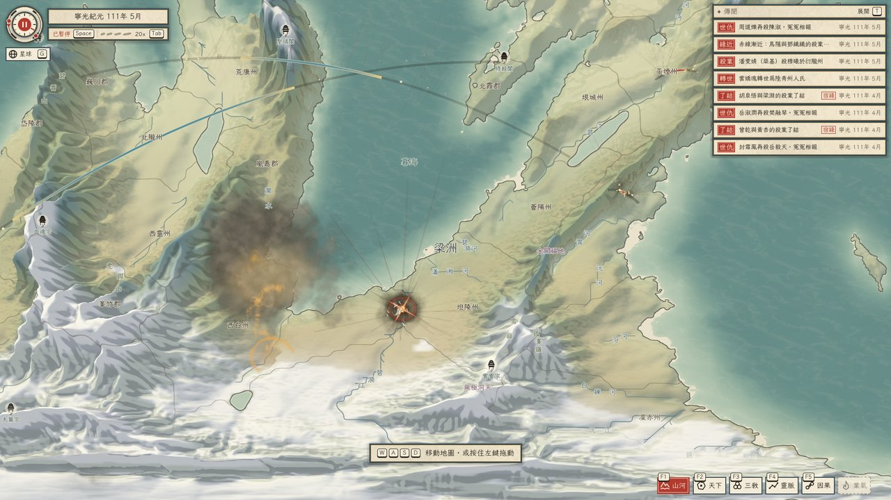

1. 傳聞簽。每一張由左到右：紅色的類別印（世仇、緣近、殺業、轉世、了結……）、一句話、年月。年月前面有時多一枚小印——「宿緣」表示這件事牽涉前世的恩怨，「高境」表示當事人境界很高，「隕落」表示有修士死在天劫裡。
2. 天劫：灰黑的劫雲聚在一個人頭上，橘色的雷一道道打下來。渡得過就升一個大境界，渡不過就死。
3. 了結：兩個人之間的宿緣在這裡算清了，地圖上會爆出一團光。

事情發生在畫面外時不會演出；之後在傳聞裡點那一張，鏡頭飛過去時會補演一次。

按 T，或點傳聞簽右上的「展開」。

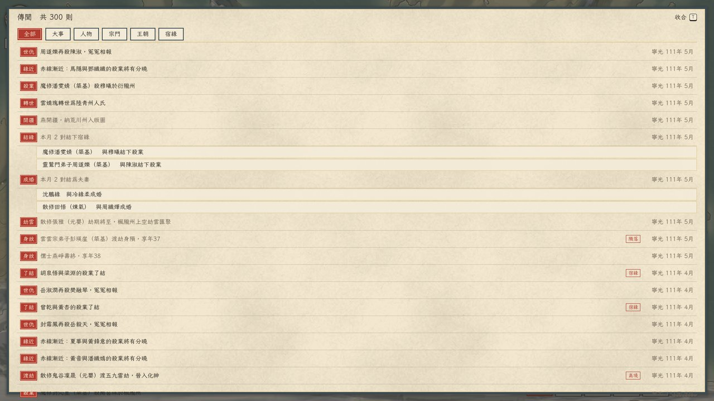

1. 分類：全部、大事、人物、宗門、王朝、宿緣。點了只看那一類。
2. 一張傳聞。點它，傳聞收起來，鏡頭飛到出事的地方。滑鼠停在一張上，右邊會出現「看人物」與「溯因」兩個小鈕。
3. 同一個月裡同一類的小事會合成一張，例如「本月 2 對結下宿緣」，底下列出是哪幾對。
4. 小印，同上一張圖的說明。
5. 「收合」（T 或 Esc）回到地圖。

展開時時間會自動停住，收合後回到原來的速度。傳聞最多留最近 300 則，更早的會被擠掉。

**測試項目**

- [ ] 20× 跑兩分鐘內，傳聞簽出現至少五種不同的類別印。
- [ ] 收合時每一張的句子讀得懂是誰做了什麼。句子太長被「…」切掉、看不出人名的，抄下來（已知問題 1）。
- [ ] T、點「展開」都能開；T、Esc、點「收合」都能關。
- [ ] 六個分類鈕各點一次，列出的東西符合那一類。
- [ ] 展開時日期不動；收合後速度與展開前相同。
- [ ] 點一張有地點的傳聞，鏡頭飛到那裡。事情本來就在畫面內時鏡頭幾乎不動，看起來像沒反應（已知問題 2），記下你有沒有被搞糊塗。
- [ ] 滑鼠停在一張傳聞上，「看人物」「溯因」兩個小鈕出現且點得到（盤點時這兩個鈕沒有用滑鼠實際點過，請特別試）。
- [ ] 看見至少一次天劫的劫雲與落雷、一次了結的光。

## 跟著做：看一個人的一生

在展開的傳聞裡，點一張的「看人物」；或在州郡卡上點一個人名。

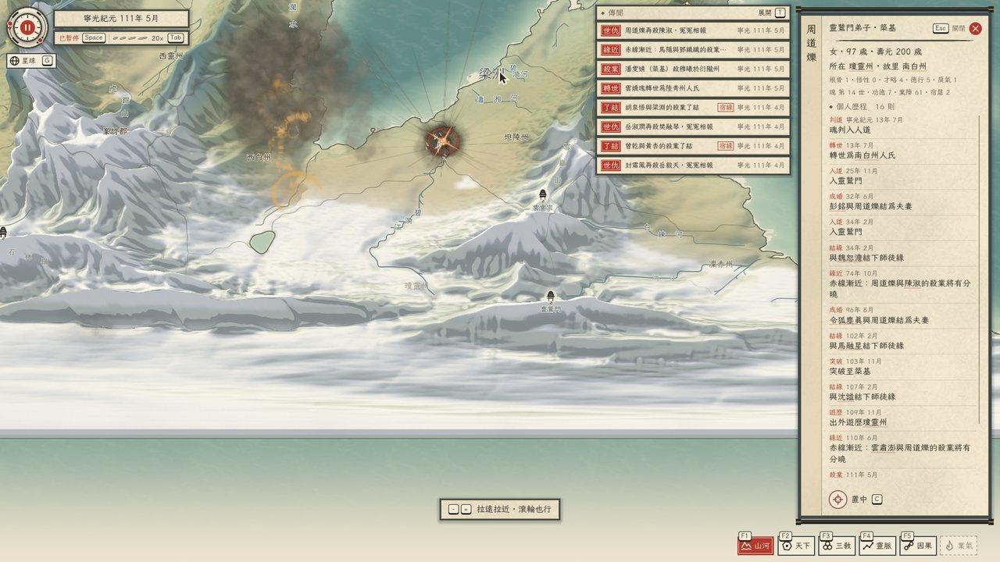

1. 人物卡。由上到下：

- **姓名**：直排在左邊。
- **門派與境界**：例如「靈鷲門弟子 · 築基」。沒有門派的寫「散修」。
- **性別、年紀、壽元；所在的州與故里**：有底線的州名可以點，會換成那個州的州郡卡。
- **資質**：根骨、悟性、才略、德行、戾氣五項。
- **魂的帳**：這個魂是第幾世、累積的功德與業障、宿慧（前世帶來的悟性）。
- **個人歷程**：這一世從投胎到現在的每一件事，舊的在上。圖上這個人是第 14 世，13 年投胎，25 年入靈鷲門，結過兩次婚，收過三個徒弟，103 年突破到築基，最後一筆是 111 年 5 月的殺業。有底線的人名可以點，會換成那個人的人物卡。
- **「置中」（C）**：鏡頭移到這個人所在的地方。

境界由低到高九級：煉氣、築基、金丹、元嬰、化神、煉虛、合體、渡劫、大乘，再上去是飛升。每升一個大境界壽元就長一截，所以這位築基修士 97 歲、壽元 200 歲。

人死了之後魂會被判入六道之一，再投胎成另一個人。新的那個人不記得前世，但前世沒了結的恩怨還跟著魂。這就是「宿緣」。

**測試項目**

- [ ] 人物卡七項都有內容；個人歷程超過一頁時能用滾輪往下捲。
- [ ] 點有底線的人名會換到那個人；點有底線的州名會換到那個州。
- [ ] 連續點進三個人之後按 Esc，是一層一層退回去，還是一次全關？記下實際的行為。
- [ ] 找一位已經死掉的人（傳聞裡「身故」那一類），他的人物卡寫得出死在哪一年、享年幾歲。
- [ ] 讀完一個人的個人歷程後，你能不能用兩三句話講出他這輩子發生了什麼？講不出來的話，是哪幾條看不懂？

## 跟著做：溯因——這件事是怎麼來的

人物卡開著時按 X，或在傳聞上點「溯因」。

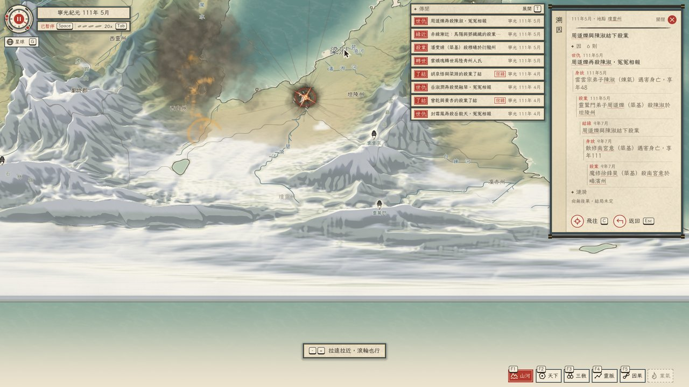

1. 事件卡。由上到下：

- **年月與地點**：地點可以點。
- **這件事本身**：「周道爍與陳淑結下殺業」。
- **「因」**：由近到遠、一層層往內縮排的因果鏈。這張圖要從最底下往上讀——9 年 7 月魔修徐鋒昊殺了南宮意；南宮意與他結下殺業；一百年後兩個魂都轉世了，換了名字，111 年 5 月周道爍殺了陳淑，是「冤冤相報」。同一筆債，隔了一世才討回來。
- **「漣漪」**：這件事之後又引出了什麼。這裡寫「尚無後果，結局未定」，表示還沒有下文。
- **「飛往」（C）與「返回」（Esc）**：飛往是把鏡頭移到出事的地方；返回是回到剛才的人物卡。

這是這一版最核心的畫面。整個遊戲想讓你看到的就是這個：眼前一樁看似沒來由的凶殺，往回翻，是上輩子欠的。

**測試項目**

- [ ] X 鍵與傳聞上的「溯因」都開得了事件卡。
- [ ] 「因」裡每一條的人名都能點；點了換到那個人的人物卡。
- [ ] 「返回」與 Esc 回到上一張卡；再按一次 Esc 全部關掉。
- [ ] 找三件類別是「世仇」或「了結」的事溯因，每一件都能從最底下那一條讀到最上面，說得出前因後果。讀不通的那一件抄下來。
- [ ] 找一件「漣漪」不是空的事（比較早發生的殺業通常有），看得懂後來怎麼了。

## 跟著做：換一種方式看地圖

右下的印匣有六枚印，按 F1 到 F6 或直接點。點印匣旁邊的「例」會顯示那一種模式的圖例。

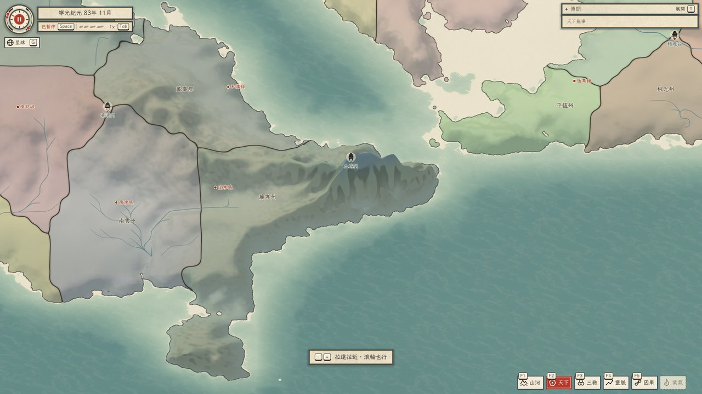

1. 印匣。亮著紅底的是現在的模式。

- **F1 山河**：預設。地形、河流、州名與城名、山門。
- **F2 天下**（上圖）：每個州塗上所屬勢力的顏色，州界加粗。看得出誰的地盤多大。

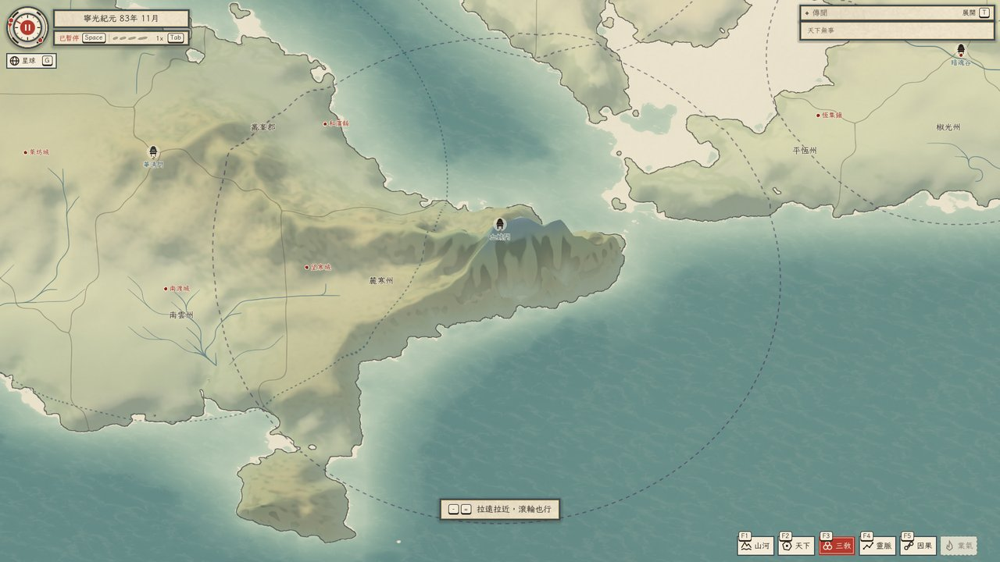

- **F3 三教**：每個宗門周圍一個虛線圈，是它的勢力範圍。州的底色表示當地信道、信佛還是信儒，愈濃愈盛；這一版多數的州還是「尚無」。

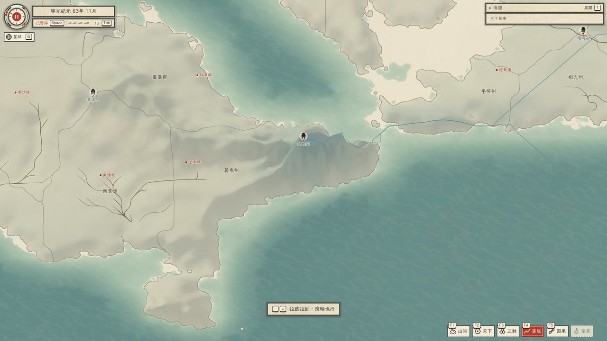

- **F4 靈脈**：地形淡掉，用藍線畫出靈氣流動的脈絡。

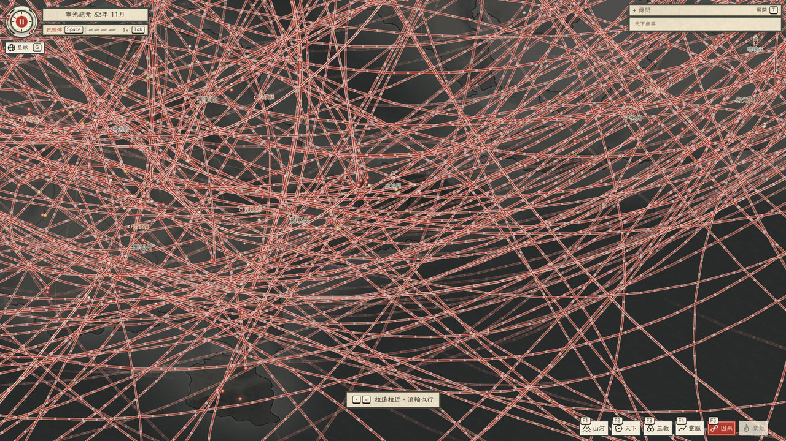

- **F5 因果**：地圖暗下來，每一條線連著兩個還有宿緣沒了結的魂。線分五種：殺業、恩義、情緣、師徒、怨。光點是魂，金色的功德多，赤色的業障重；點光點會開那個人的人物卡。世界一大，線會多到蓋滿整張圖（已知問題 4），拉近到一個州的範圍才看得清楚。
- **F6 業氣**：還沒開放，按了沒有反應。

**測試項目**

- [ ] F1 到 F5 與點印都能切換；每種模式的畫面明顯不同。
- [ ] 每種模式點「例」都有圖例，圖例上的字對得上畫面。
- [ ] F5 拉近之後分得出至少三種線；點得到光點並開出人物卡。
- [ ] F6 按了、點了都沒有反應，印是灰的。
- [ ] 不看手冊，只看圖例，你說得出 F2、F3、F4 各自在畫什麼嗎？

## 跟著做：等一次飛升

修士修到頂就會飛升，離開這個世界。這很罕見：盤點時四個世界加起來跑了 2,700 年只出現兩次。看到傳聞出現「白日飛升」就點它。

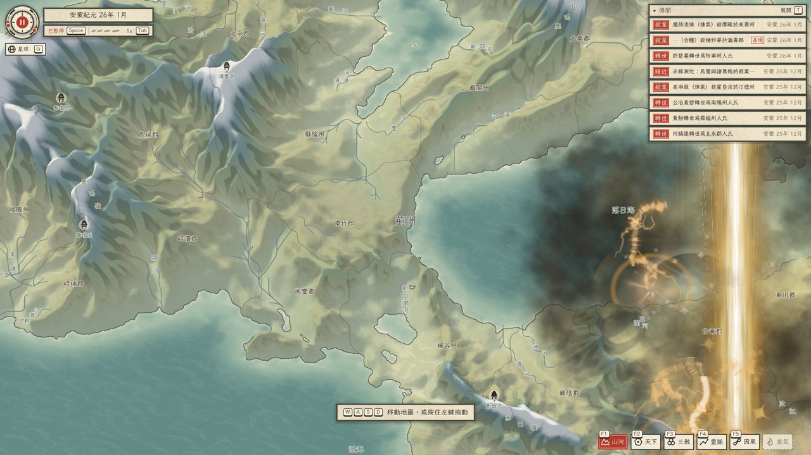

1. 飛升前先渡最後一次天劫，劫雲比平常的大。
2. 一道金色的光柱從地面升到天上。

不必特地等。開 20× 掛著跑，有看到再回報即可。

**測試項目**

- [ ] 如果看到了飛升：記下世界的種子、年月、那個人的名字，以及光柱有沒有正常演出。

## 跟著做：存檔與離開

在世界裡按 Esc。

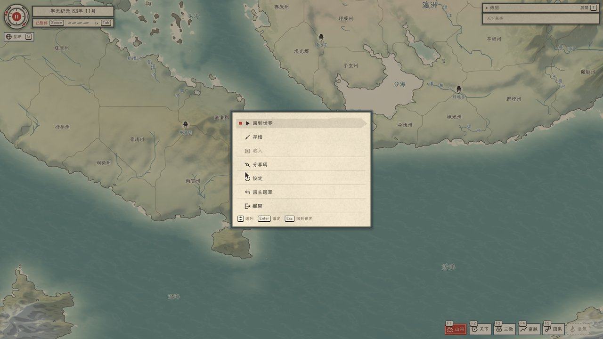

1. 由上到下：回到世界、存檔、載入、分享碼、設定、回主選單、離開。選單開著時時間是停的。

選「存檔」。

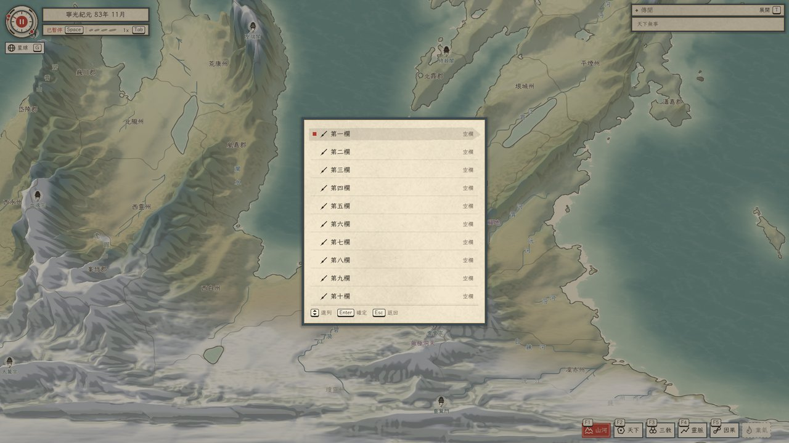

1. 十個欄位。空的寫「空欄」；存過的顯示世界名、遊戲裡的日期與存檔的時刻。選一欄按 Enter 就存。欄位裡已經有存檔時會先問要不要蓋掉，預設停在「取消」。

存檔記的是世界的種子與到目前為止過了多久，載入時遊戲把世界重新跑一遍到那個時刻，所以載入要等幾秒到幾十秒，世界愈老等愈久。

「分享碼」是一段文字，貼給別人，對方從主選單的「分享碼」→「從剪貼簿匯入」就能開出同一個世界。

**測試項目**

- [ ] 存到第一欄，欄位顯示世界名與日期。
- [ ] 存完之後不關選單，按 Esc 回到選單第一頁，「載入」已經選得到。
- [ ] 回主選單（會提醒沒存的進度不保留），「繼續」與「載入」變成可選；載入後世界的日期與存檔時相同，地圖與人名也相同。
- [ ] 同一欄再存一次，會問要不要蓋掉；選「取消」不會蓋。
- [ ] 「複製這個世界的分享碼」之後，在記事本貼上，有一段文字。關掉遊戲重開，從主選單匯入，開出來的世界與原來相同（盤點時這一項沒有驗到，請特別試）。
- [ ] 把分享碼刪掉幾個字再匯入，遊戲會說「分享碼不完整或已損壞」，不會當掉。

## 查閱：操作一覽

| 要做什麼 | 鍵盤 | 滑鼠 |
|---|---|---|
| 移動地圖 | W A S D、方向鍵 | 左鍵拖動；游標貼畫面邊緣（設定可關） |
| 拉近／拉遠 | `=`／`-` | 滾輪 |
| 轉向 | Q／E | 右鍵拖動 |
| 平面與星球切換 | G | 點視角鈕 |
| 暫停／繼續 | Space | 點天時儀中心 |
| 換速度 | Tab | 點狀態列的刻線 |
| 地圖模式 | F1–F6 | 點印匣 |
| 傳聞展開／收合 | T | 點「展開」「收合」 |
| 看州郡 | — | 點地圖上的州 |
| 看人物 | — | 點人名、點因果模式的光點、傳聞上的「看人物」 |
| 溯因 | X（人物卡開著時） | 傳聞上的「溯因」 |
| 鏡頭移到卡上的對象 | C | 點「置中」「飛往」 |
| 返回上一張卡／關閉 | Esc | 點「返回」、右上的紅鈕 |
| 遊戲中的選單 | Esc（沒有卡開著時） | — |

搖桿：遊戲接了搖桿（左搖桿移動、右搖桿游標、LB／RB 換地圖模式等），但只有 LB／RB 驗過，這一版請用鍵盤滑鼠測。觸控只驗過兩指縮放。

## 查閱：傳聞的類別印

| 印 | 意思 |
|---|---|
| 轉世 | 一個魂投胎成了新的人 |
| 身故 | 有名之人死了：壽終、渡劫失敗、被殺 |
| 成婚 | 兩人結為夫妻 |
| 結緣 | 兩人之間結下一條宿緣（殺業、恩義、情緣、師徒、怨） |
| 緣近 | 「赤線漸近」：兩個有宿緣的人就要碰上了 |
| 了結 | 一條宿緣算清了 |
| 殺業 | 一個人殺了另一個人 |
| 世仇 | 「冤冤相報」：前世的殺業這一世又殺回去 |
| 劫雲 | 有人的天劫快到了，劫雲開始聚 |
| 渡劫 | 天劫渡過了，晉入下一個大境界 |
| 開疆 | 一個王朝把一個州納入版圖 |
| 天書 | 天書添了一頁（天書本身還不能翻） |

這張表只列了盤點時實際看到的印。看到表上沒有的印，請回報它的字與那一句話。

## 現有系統總表

世界裡自己在發生的事。「有畫面」是你在遊戲裡看得到；「只在背後」是模擬有在算，但這一版沒有專門的畫面，頂多在傳聞裡出現一句話。

| 系統 | 在做什麼 | 現況 |
|---|---|---|
| 生死與輪迴 | 人出生、成年、死亡；死後魂受審判入六道，再投胎；功德、業障、宿慧跟著魂走 | 有畫面：人物卡、傳聞 |
| 修行 | 入道、拜入宗門、突破境界、渡天劫、入魔、飛升 | 有畫面：人物卡、傳聞、天劫與飛升的演出 |
| 宿緣（因果） | 殺業、恩義、情緣、師徒、怨五種線；結下、漸近、了結、淡去；前世的仇這一世報 | 有畫面：事件卡的因果鏈、F5 因果模式、了結的演出 |
| 婚配 | 成婚 | 有畫面：傳聞、個人歷程 |
| 遊歷 | 修士離開所在的州到別處 | 只在個人歷程裡 |
| 宗門 | 立派、掌門繼位、宗門之戰、覆滅 | 只在背後：傳聞有一句話，F3 畫勢力範圍；沒有宗門的命簿 |
| 王朝 | 建國、開疆、叛亂、內戰、篡位、割據、遷都、宣戰、滅亡 | 只在背後：傳聞有一句話，F2 畫版圖；沒有王朝的命簿 |
| 民生 | 各州人口增減、饑荒、賑濟、墾林 | 只在背後：州郡卡的人口與承載 |
| 天地 | 寒暖、靈潮起落、靈脈改道、陸地相連 | 天時儀的兩段弧線；F4 畫靈脈 |
| 地圖演出 | 天劫、了結、飛升三種 | 有畫面 |

還沒做進來的，設計裡有、這一版沒有：

| 還沒有的 | 說明 |
|---|---|
| 司命的權能 | 出手干預世上的人與事。這是遊戲的主要玩法，目前完全沒有，所以這一版只能看 |
| 關注一個人 | 釘住某個魂，他轉世之後繼續追蹤，他的事優先告訴你 |
| 天書 | 主選單與傳聞裡看得到名字，翻不開 |
| F6 業氣模式 | 印是灰的 |
| 宗門、王朝的命簿 | 點不到宗門與王朝 |
| 天下冊 | 整個世界的統計圖表（各境界多少人、宗門榜、未了的宿緣……） |
| 人物的頭像 | 人物卡上沒有臉 |
| 地圖上的人 | 天劫、了結的演出裡只有雲與光，沒有人 |
| 聲音 | 沒有音樂與音效 |
| 僧人、寺院、書院、魔門、妖域、疫病 | 設計裡有，模擬還沒有 |

## 已知問題

以下是已經知道的，遇到不必重複回報；情況和下面寫的不一樣才回報。

1. 傳聞簽收合時，長句子用「…」切掉，有時連人名一起切掉；展開成全螢幕看得到完整的句子。
2. 點傳聞時事情本來就在畫面內，鏡頭幾乎不動，看起來像沒反應。
3. 地圖往南拉到底，下緣露出一條白帶與空白的海。
4. F5 因果模式在大世界裡線太多，拉遠時整張圖是一片紅。
5. 命簿收起來的半秒內按 Esc 不會開選單，要再按一次。
6. 開天要等十幾到二十幾秒，畫面上只有一句「稍候片刻」，沒有進度。
7. F6 業氣的印是灰的，點了沒有反應。

## 怎麼回報

每一條回報請附：

- 封面上的版本。
- 世界的分享碼（Esc →「分享碼」→「複製」），或開新世界時的種子與改過的選項。
- 左上角的日期。
- 你做了什麼：按了哪些鍵、點了哪裡，照順序寫。
- 你看到什麼，以及你原本以為會看到什麼。
- 截圖。看不懂的句子直接把那一句抄下來。

「看不懂」也是問題，和當掉一樣要回報。這一版最需要知道的是：哪一個畫面、哪一句話讓你不知道世界在發生什麼。
